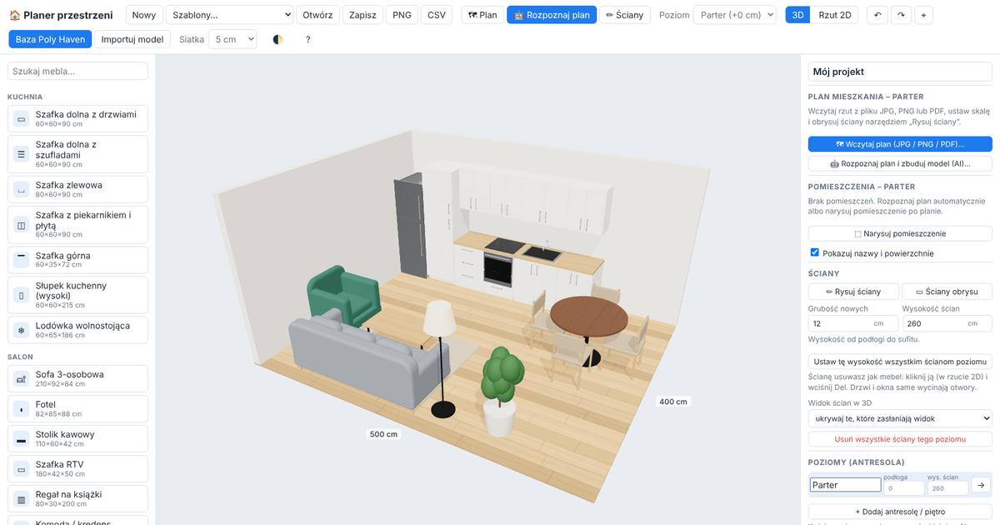

# Planer przestrzeni 🏠

## 👉 [Otwórz planer: happychocolat3.github.io/Planer-przestrzeni](https://happychocolat3.github.io/Planer-przestrzeni/)

Działa w przeglądarce (komputer, tablet, telefon) – bez instalacji i bez logowania.

[](https://happychocolat3.github.io/Planer-przestrzeni/)

Przeglądarkowy planer wnętrz: wizualizacja **3D** i **rzut 2D**, dodawanie / usuwanie / przesuwanie mebli,
zmiana **kolorów**, **materiałów** i **uchwytów**.

## Uruchomienie

```bash
npm install
npm run dev      # serwer deweloperski: http://localhost:5173
npm run build    # wersja produkcyjna w katalogu dist/ (działa z dowolnego folderu / hostingu)
```

Publikacja online: w ustawieniach repozytorium *Settings → Pages → Source* wybierz **GitHub Actions** –
workflow `.github/workflows/pages.yml` zbuduje i opublikuje aplikację po każdym pushu do domyślnej gałęzi repozytorium
(można go też uruchomić ręcznie w zakładce *Actions*). Adres: `https://<użytkownik>.github.io/<repozytorium>/`.

## Funkcje

- **🤖 Rozpoznawanie planu (AI)** – wczytany rzut (zdjęcie, skan, PDF) odczytuje model Claude (Anthropic):
  wymiary z opisów, ściany, drzwi, okna, pomieszczenia (z nazwami i powierzchnią), kuchnię, łazienkę, schody,
  a także kolejne rysunki z arkusza (np. antresolę) – i planer od razu buduje z tego model 3D z podkładem planu.
  Potrzebny jest własny klucz API Anthropic (wpisywany w przeglądarce, wysyłany tylko do api.anthropic.com).
- **Pomieszczenia** – osobne elementy z nazwą, powierzchnią i własną podłogą; lista „Pokój” w pasku narzędzi
  pokazuje wybrane pomieszczenie osobno (z jego ścianami i wyposażeniem). Pomieszczenie można też narysować ręcznie.
- **Plan mieszkania jako podkład** – wczytaj rzut z **JPG / PNG / PDF** (z wielostronicowego PDF wybierasz stronę).
  Skalę ustawiasz, klikając dwa końce odcinka o znanej długości i wpisując ją w cm. Plan można przesuwać,
  obracać, zmieniać przezroczystość; każdy poziom (parter, antresola) może mieć własny plan.
- **Ściany jako elementy** – rysujesz je po planie (narzędzie „✏ Ściany”, klawisz `W`, przyciąganie do 45°
  i końców ścian), a każdą – także ściany obrysu – możesz zaznaczyć, przesunąć, zmienić jej długość, grubość,
  wysokość, kolor albo **usunąć** (`Del`). Drzwi i okna same wycinają w ścianach otwory.
- **Antresola / poziomy** – dowolna liczba poziomów z wysokością podłogi; katalog „Antresola i schody”:
  podłoga antresoli (strop), schody proste pełne i ażurowe (wysokość dobiera się do poziomu wyżej),
  balustrady prętowe i szklane, **skos dachu z oknami dachowymi** (wysokość dolnej i górnej krawędzi, ścianka
  kolankowa) oraz **otwór w podłodze antresoli** (wycina strop – widok na parter). Widok: bieżący poziom, bieżący + niższe lub wszystkie.
  Każdy poziom ma własną wysokość ścian (np. parter 265 cm, antresola 220 cm) – zmiana dopasowuje ściany, schody
  i położenie wyższych poziomów.

- **Pomieszczenie** – szerokość, długość, wysokość; materiał i kolor podłogi oraz ścian; ściany od strony kamery
  chowają się automatycznie, żeby było widać wnętrze.
- **Katalog ~75 mebli** o typowych wymiarach (kuchnia, salon, sypialnia, jadalnia/biuro, łazienka, przedpokój, architektura –
  drzwi, okna, ścianki działowe). Każdy mebel jest parametryczny: zmieniasz szerokość/głębokość/wysokość,
  liczbę drzwi, szuflad, półek, siedzisk; są też szybkie przyciski z typowymi wymiarami (np. łóżko 90–200 cm,
  szafki kuchenne 30–100 cm).
- **Edycja** – przeciąganie myszą z przyciąganiem do siatki i ścian (drzwi i okna same „wchodzą” w ścianę),
  obrót, duplikowanie, blokada, cofnij/ponów, wysokość montażu (np. szafki górne).
- **Kolory i materiały** dla każdej części mebla osobno (korpus, fronty, blat, tapicerka, nogi…):
  lakiery mat/satyna/połysk, okleiny drewnopodobne (dąb, orzech, jesion, sosna, wenge), tkanina, welur, skóra,
  metale, szkło, marmur, granit, beton, ceramika, panele, jodełka, płytki – plus paleta popularnych kolorów
  i dowolny kolor z próbnika.
- **Uchwyty** – reling, reling długi, gałka, muszelka, pierścień, krawędziowy, gola, skórzany pasek;
  10 wykończeń (chrom, stal, czarny mat, mosiądz, złoto, miedź, grafit, biały, drewno, skóra); strona zawiasów.
  Przycisk „Zastosuj fronty i uchwyty do wszystkich szafek” zmienia całą zabudowę jednym kliknięciem.
- **Darmowe bazy** – przycisk *Baza Poly Haven* przegląda [polyhaven.com](https://polyhaven.com)
  (tekstury i modele 3D na licencji **CC0**). Tekstury (z mapami normalnych i chropowatości, w rzeczywistej skali)
  nakładasz na wybrany mebel, podłogę lub ściany; modele dodajesz do sceny. Wymaga internetu.
- **Własne modele** `.glb` / `.gltf` (np. z Sketchfab, BlenderKit, katalogów producentów).
- **Tryb ciemny** – przycisk 🌓 w pasku: automatyczny (jak w systemie) → jasny → ciemny; wybór jest zapamiętywany.
- **Zapis** – automatyczny w przeglądarce, plik projektu `.json`, obraz `.png` wizualizacji
  oraz lista elementów `.csv` (wymiary, materiały, uchwyty – przydatna do wyceny).

## Sterowanie

| Akcja | Jak |
|---|---|
| Dodaj mebel | klik w katalogu albo przeciągnij na widok |
| Rysuj ściany | `W` lub „✏ Ściany”; klikaj narożniki, `Esc` / podwójny klik kończy ciąg |
| Przesuń | przeciągnij lewym przyciskiem / strzałki |
| Obróć | `R` (90°), `Shift+R` (−90°), `Q` / `E` (15°) |
| Usuń / duplikuj | `Del` / `Ctrl+D` |
| Cofnij / ponów | `Ctrl+Z` / `Ctrl+Y` |
| Kamera 3D | lewy przycisk na pustym miejscu – obrót, prawy – przesuwanie, kółko – zoom |

## Technologia

[three.js](https://threejs.org) + [Vite](https://vitejs.dev), czysty JavaScript bez frameworków.

```
src/
  catalog3.js   – kanapa rozkładana i biurko narożne (wybór stylu, mechanizmu, stanu złożona/rozłożona)
  catalog2.js   – rozszerzony katalog (kanapy, narożniki, zlewy, słupki, wyspa, szafy przesuwne, łazienka, przedpokój)
  main.js       – interfejs (katalog, panel właściwości, pasek narzędzi, Poly Haven)
  scene.js      – scena 3D, kamery, pomieszczenie, zaznaczanie i przeciąganie
  furniture.js  – katalog parametrycznych mebli i uchwytów
  materials.js  – materiały, proceduralne tekstury, wykończenia uchwytów
  polyhaven.js  – klient API Poly Haven (CC0)
  state.js      – projekt, poziomy, historia zmian, autozapis
  assets.js     – duże pliki (plany, modele) w IndexedDB przeglądarki
  planimport.js – wczytywanie planu z obrazu lub PDF (pdf.js)
  ai.js         – rozpoznawanie planu przez Claude (Anthropic SDK, structured outputs)
  planBuild.js  – budowa modelu (poziomy, ściany, otwory, pomieszczenia, wyposażenie) z rozpoznanego planu
```
